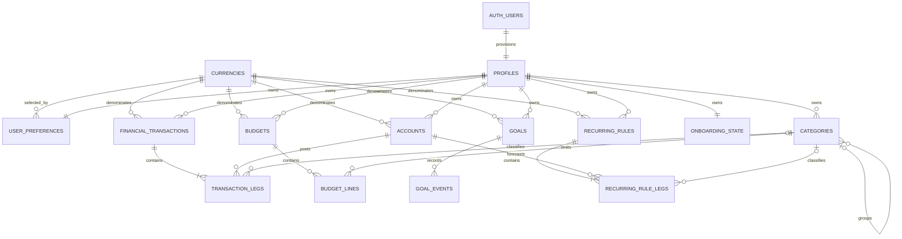

# Database

`Migrations/` is Seuly's canonical fresh-deploy baseline: 34 timestamped SQL
files applied once in lexical order. Each file owns a transaction. Never edit,
skip, reorder, or duplicate an applied migration; append a new one.

## Schema map



The 14 tables are `currencies`, `profiles`, `user_preferences`,
`onboarding_state`, `accounts`, `categories`, `financial_transactions`,
`transaction_legs`, `budgets`, `budget_lines`, `goals`, `goal_events`,
`recurring_rules`, and `recurring_rule_legs`.

Three security-invoker/barrier views expose computed reads:
`profile_overview`, `goal_overview`, and `account_overview`.

## Money and ledger rules

Amounts are signed `bigint` minor units, bounded to ±9 quadrillion. Currency
metadata defines 0–3 decimal minor units. An income leg is positive, expense is
negative, and a transfer has equal opposite legs that sum to zero. Account
balances are opening balance plus posted legs; void transactions do not count.
Recurring rules forecast future activity and never auto-post transactions.

## Client write API

Authenticated clients have execute access to exactly eight public RPCs:

- `complete_onboarding`
- `save_account`
- `save_financial_transaction`
- `void_financial_transaction`
- `save_budget_line`
- `create_goal`
- `record_goal_contribution`
- `create_recurring_rule`

Creates accept stable request UUIDs. Helpers bind a retried identifier to the
same normalized payload, validate ownership and related records, and reject a
conflicting replay.

## Authorization

All 14 tables enable and force RLS. Authenticated users receive scoped `SELECT`
on tables/views and no direct table write grants. Policies compare ownership
with `auth.uid()` or traverse an owned parent. Security-definer RPCs set an
empty search path and derive the caller from Auth. Private helpers cannot be
executed by `anon` or `authenticated`; `service_role` bypass remains an
operator responsibility.

## Migrations and verification

Verify the committed CLI link before applying the baseline:

```sh
test "$(readlink supabase/migrations)" = "../Migrations"
supabase db reset
```

For hosted deployment use `supabase db push` only after linking a new, backed-up
project. Follow `Migrations/README.md` for reconciliation. Before release, test
anonymous denial, direct-write denial, two-user isolation, all RPCs, replay
safety, balanced transfers, and invoker-view behavior on a disposable project.
